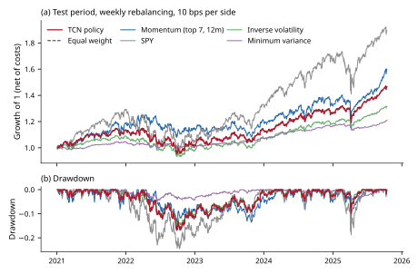
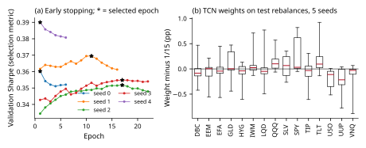

# End-to-End Sharpe Training of a TCN Allocation Policy on 15 ETFs Collapses to Equal Weight

A PyTorch study of direct policy learning for weekly long-only ETF allocation, evaluated against classical baselines in one backtest engine.

## Abstract

We train a temporal convolutional network (TCN) that maps 60 days of per-asset features to portfolio weights for 15 liquid US-listed ETFs. The loss is the negative Sharpe ratio of next-day portfolio returns net of costs, plus turnover and tail-loss penalties. Training uses 2007-2017, early stopping uses 2018-2020, and the test period runs from January 2021 to October 2025, with weekly rebalancing and 10 bps per side. On the test period the policy earns an excess Sharpe ratio of 0.512 (sd 0.006 over 5 seeds), against 0.515 for equal weight, 0.588 for 12-month momentum and 0.674 for SPY alone. The learned weights stay within about one percentage point of 1/15: the network converges to the equal-weight portfolio, and its paired Sharpe difference to equal weight lies between −0.013 and +0.005 across seeds. The main limitation is that the model design was chosen while the test period was already visible, so even this null result is not a clean hold-out.

## 1. Setup

**Universe.** SPY, QQQ, IWM, EFA, EEM, TLT, TIP, LQD, HYG, GLD, SLV, DBC, USO, VNQ, UUP (`meta/universe.yaml`): US and international equities, Treasuries, credit, commodities, real estate and the dollar.

**Data.** Daily dividend-adjusted closes from Yahoo Finance (`yfinance`, `auto_adjust=True`), restricted to NYSE sessions on which all 15 ETFs trade (2007-04-11 to 2025-10-14, 4,659 sessions). The risk-free rate is the FRED 3-month T-bill (DTB3), converted to a daily rate as DTB3/252.

**Splits.**

| Split | Period | Use |
|---|---|---|
| Train | 2007-04 to 2017-12 | gradient updates (2,313 daily samples after the feature warm-up) |
| Validation | 2018-01 to 2020-12 | early stopping on Sharpe |
| Test | 2021-01-01 to 2025-10-14 | reported once per seed |

**Backtest protocol.** Every strategy runs through the same engine (`src/backtest_loop.py`). On each rebalance date t (the trading day closest to each Friday), the strategy sees only data up to the close of t-1, sets long-only weights, pays 10 bps per side on the weight change, and earns the close-to-close return of t. Between rebalances, weights drift with prices. Baselines receive the full return history before each rebalance, so 12-month estimates are available from the first test week. Tests in `tests/test_no_lookahead.py` check that features, targets and backtest weights are unchanged when future prices are perturbed.

## 2. Method

**Features.** Ten features per asset (150 inputs per day): log returns over 1, 5 and 20 days; EWMA volatility (λ = 0.94); 12-month momentum as an expanding z-score and as a cross-sectional rank; 60-day skewness; drawdown from the 252-day high; and two market-wide signals, the 20-day cross-sectional dispersion and the ratio of 20-day to 60-day volatility of the equal-weight return. Every feature at date t uses closes up to t only. Features are not standardised.

**Model.** A linear projection to 64 channels, two causal dilated TCN blocks (kernel 5, dilation 1 and 2), self-attention over the 60-step window, and a two-layer head producing 15 logits (109k parameters). Weights are the softmax of the logits, projected onto a 20% cap per asset.

**Loss.** For a batch of daily samples, with net return R = wᵀr − c‖w − w_prev‖₁:

L = −mean(R)/std(R) + 2.0 · turnover + 0.5 · pinball loss at the 95% quantile of −R.

Adam (lr 1e-3, gradient clipping 1.0), batch 128 in time order, up to 30 epochs, early stopping with patience 5 on the validation Sharpe of a daily-rebalanced pass. Training runs on CPU with deterministic kernels, seeds 0-4.

**Baselines.** Equal weight (1/N); inverse volatility (trailing 252-day volatility); long-only minimum variance (sample covariance over 252 days plus a 1e-5 ridge); cross-sectional momentum (equal weight on the 7 assets with the highest trailing 12-month return); 100% SPY. The 20% cap applies only to the learned policy.

## 3. Results

<p align="center"></p>

*Figure 1. Test period, net of costs. The TCN curve (mean of 5 seeds) lies on top of equal weight.*

| Test, 2021-01 to 2025-10 | CAGR | Vol. | Excess Sharpe | Max DD | Turnover / yr | β to SPY |
|---|---|---|---|---|---|---|
| TCN policy (5 seeds, mean) | 8.35% | 10.46% | 0.512 | −16.9% | 0.76 | 0.49 |
| Equal weight | 8.36% | 10.42% | 0.515 | −16.7% | 0.76 | 0.49 |
| Inverse volatility | 5.92% | 7.58% | 0.373 | −14.8% | 0.80 | 0.35 |
| Minimum variance | 4.07% | 3.51% | 0.239 | −4.5% | 3.72 | 0.09 |
| Momentum (top 7, 12m) | 10.37% | 12.69% | 0.588 | −13.8% | 8.16 | 0.50 |
| SPY | 14.31% | 17.32% | 0.674 | −24.5% | 0 | 1.00 |

*Table 1. Excess Sharpe is computed on daily returns over DTB3 and annualised with √252. Turnover is Σ|Δw| summed over a year, so the annual cost is 10 bps × turnover (7.6 bps for equal weight, 82 bps for momentum). The seed standard deviation of the TCN Sharpe is 0.006. Source: `results/metrics_test.csv`.*

<p align="center"></p>

*Figure 2. (a) Validation Sharpe by epoch; the selected epoch ranges from 1 to 17 across seeds. (b) Deviation of the test-period weights from 1/15, all rebalances and seeds (whiskers at the 1st and 99th percentiles).*

**The policy is equal weight.** Across seeds, the mean L1 distance between the learned weights and 1/15 is 0.007 to 0.073, and no asset deviates by more than about one percentage point (Fig. 2b). An untrained network is already this close, because the softmax of small logits is near uniform (L1 distance 0.05 to 0.09 at initialisation on the test inputs). Training does not move the policy away from 1/N. The paired difference in excess Sharpe against equal weight ranges from −0.013 to +0.005 across seeds, and every 95% interval from a 21-day moving-block bootstrap lies inside [−0.035, +0.014] (`results/sharpe_diff_test.csv`).

**Validation does not reward training.** For two seeds the best validation Sharpe is at epoch 1, and it falls while the training loss keeps decreasing (Fig. 2a). The supervision signal is a one-day return, and what the model fits in sample does not carry over to 2018-2020.

**Baselines.** Momentum and SPY have the highest test Sharpe ratios, but the intervals are wide: momentum minus TCN is +0.07 to +0.09 across seeds, with 95% intervals of about [−0.37, +0.48]. With 4.8 years of daily data, no Sharpe difference between the diversified strategies is statistically resolved. On validation the ranking differs: inverse volatility (0.661) and momentum (0.655) lead, and equal weight (0.476) trails (`results/metrics_val.csv`).

## 4. Limitations

- **The test period is not a clean hold-out.** An earlier version of this project compared model variants (feature sets, distillation from momentum, fine-tuning) on 2021-2025 before settling on this configuration. The conclusion that the policy reduces to equal weight does not depend on this, but no number here should be read as a pristine out-of-sample estimate.
- **Training objective.** Samples are daily while trading is weekly. The turnover penalty compares each sample's weights with the weights predicted for the sample at the same position in the previous batch (128 trading days earlier), not with the previous rebalance, so it does not penalise actual trading.
- **Splits.** There is no embargo between splits. The last training target (the return of the first trading day of 2018) lies in the validation period, an overlap of one day.
- **Data.** Yahoo adjusted prices are re-adjusted after each distribution, so a later download changes price levels slightly but leaves returns nearly unchanged. One universe of 15 ETFs, one cost level, one rebalance frequency.
- **Baselines** are simple and uncapped; minimum variance uses the sample covariance without shrinkage toward a structured target.

## Reproducibility

Python 3.12, pinned versions in `requirements.txt`. Data comes from public sources (Yahoo Finance via `yfinance`, FRED via `pandas-datareader`) and is not committed. The results in this README were produced on 2026-11-13 with data downloaded the same day.

```sh
make env        # uv venv + pinned requirements
make data       # data/processed/prices_panel.parquet, data/rf/tbill_3m_daily.parquet
make train      # 5 seeds on CPU, about 2 minutes -> results/runs/, results/training_log.csv
make eval       # baselines and tables -> results/metrics_{val,test}.csv, results/sharpe_diff_test.csv
make figures    # figures/*.svg
make test       # causality and cost tests
```

| Path | Content |
|---|---|
| `src/data_ingest.py` | Download, NYSE calendar alignment, risk-free rate |
| `src/features.py` | Features, next-day excess-return targets, sequences |
| `src/models/tcn_policy.py` | TCN policy network |
| `src/losses.py` | Sharpe, turnover and pinball losses |
| `src/train.py` | Training, early stopping, per-seed backtests |
| `src/backtest_loop.py` | Shared backtest engine |
| `src/baselines.py` | Classical allocation rules |
| `src/evaluate.py`, `src/metrics.py` | Metrics, block bootstrap |
| `src/figures.py` | Figures |

## References

- S. Bai, J. Z. Kolter, V. Koltun. An Empirical Evaluation of Generic Convolutional and Recurrent Networks for Sequence Modeling. arXiv:1803.01271, 2018.
- V. DeMiguel, L. Garlappi, R. Uppal. Optimal Versus Naive Diversification: How Inefficient is the 1/N Portfolio Strategy? *Review of Financial Studies* 22(5), 2009.

Code released under the MIT license.
